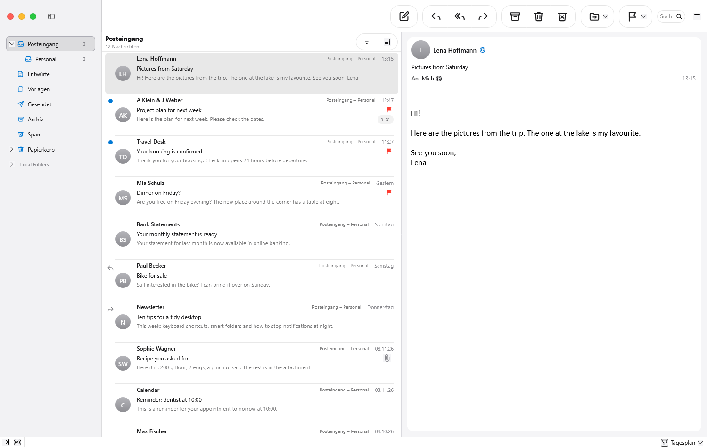
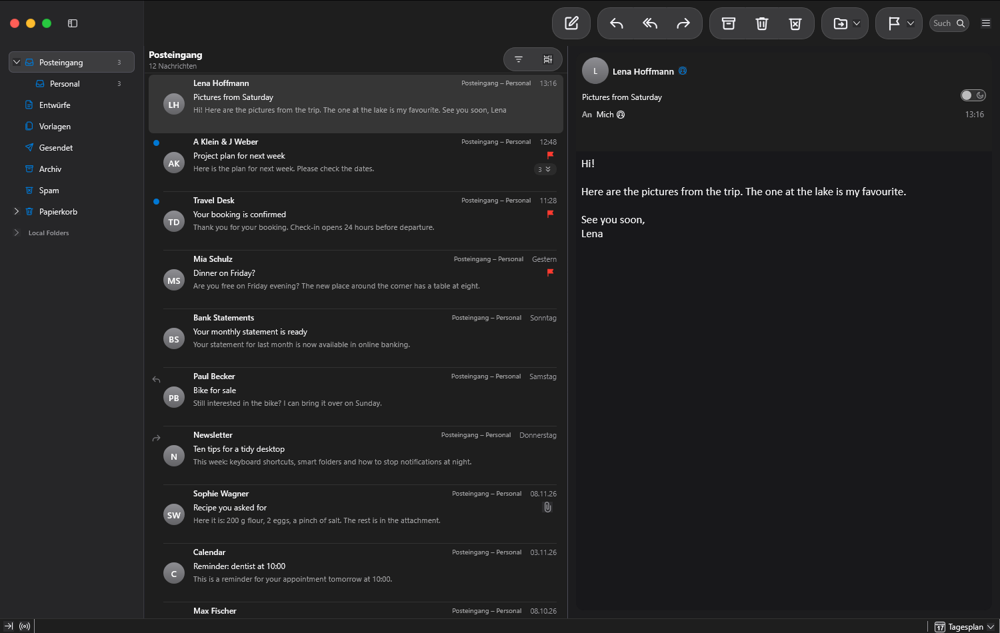

# Thunderbird like Apple's Mail

A look for Thunderbird that follows Mail on macOS 26, in light and dark, for Windows, macOS and Linux.
Taken out of [mbp115-linux](https://github.com/AlexG-78/mbp115-linux), where it is the `mail` step.




- Grey sidebar, a plain message list with blue unread dots, rounded selection, traffic-light window buttons
- Toolbar in capsules with line icons: New | Reply, Reply All, Forward | Archive, Delete, Junk | Move | Flag
- One Inbox for all accounts, three columns, the message header as a card
- Compose window, contacts, calendar, every dialog, popup and settings page in the same look
- Add-on *Mail Quick Actions*: quick actions on the message under the pointer, ⌫ deletes in the list, pinch to
  zoom, conversations, contact pictures or initials, two-line previews. Nothing is loaded from the internet.

## Install

Needs Thunderbird 128 or newer and Python 3. Download or clone this repository, **quit Thunderbird**, then:

```
python install.py
```

(`py install.py` on Windows, `python3 install.py` on Linux and macOS.) It lists the changes, asks, and applies them
to the default profile; `--profile DIR` names another one. Start Thunderbird and turn the add-on on once:
app menu > Add-ons and Themes > Extensions > Mail Quick Actions.

Remove it again with `python install.py remove`: the settings from before come back, settings you changed since are
kept. After an update of this repository, run `python install.py` again.

## What it changes in the profile

| Where | What |
|---|---|
| `chrome/userChrome.css`, `chrome/userContent.css` | a marked block (`mbp115-mail begin` … `end`); your own rules stay |
| `prefs.js` | the settings in [prefs.js](prefs.js) |
| `xulstore.json` | the layout in [xulstore.json](xulstore.json): toolbar, sidebar, message header |
| `extensions/` | the add-on in [addon/](addon/) as an .xpi |
| `mail-look.backup.json` | the values from before, for `remove` |

## Platforms

- **Windows** (tested with Thunderbird 160): the window buttons move to the left, Close first, as on a Mac. Windows
  with a title bar of their own (compose, a message in its own window) keep Windows' buttons.
- **Linux**: the window buttons follow the desktop's button layout. The desktop parts (dock icon, GTK title bars and
  temporary folder of the snap) stay in [mbp115-linux](https://github.com/AlexG-78/mbp115-linux).
- **macOS**: not tested.

## Tests

- `python test/test_install.py` - install, change, install again, remove on a made-up profile
- `python test/shot.py out.png [--dark]` - a screenshot of a headless Thunderbird with made-up mails and the look
- `test/run.sh`, `test/survey.sh` - the same in a headless GNOME Shell (Linux, Thunderbird snap)

## License

MIT, see [LICENSE](LICENSE). Not affiliated with Apple or Mozilla.
